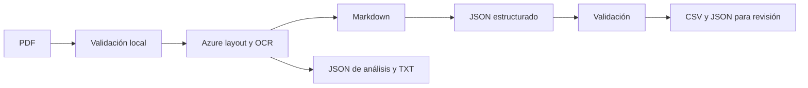

# Real Estate Document Extractor

## Descripción
Versión de portafolio basada en una automatización aplicada a un caso real. Extrae campos de fichas inmobiliarias PDF en japonés, español o inglés para su revisión humana.

## Problema
Los documentos tienen formatos variables y distinguen superficies y precios que no deben mezclarse ni convertirse sin evidencia.

## Solución y arquitectura
Azure AI Document Intelligence, modelo `prebuilt-layout`, devuelve OCR/layout en Markdown. El script envía ese texto a un modelo mediante Structured Outputs con JSON Schema estricto y valida campos y tipos antes de escribir resultados. Los documentos se tratan como datos, no como instrucciones.

## Tecnologías
Python, requests, pypdf, Azure AI Document Intelligence y API de OpenAI.

## Estructura
- `main.py`: validación, extracción, trazabilidad y exportación.
- `pdfs/`: entrada local excluida de Git.
- `resultados/`: salidas privadas excluidas de Git.
- `examples/`: datos sintéticos, sin llamadas remotas.
- `tests/`: comprobaciones offline añadidas para el portafolio.

## Mi participación
Automatización de extracción y organización de información documental, según la descripción del autor. La comparación del código recuperado y las mejoras posteriores están en [PROVENANCE.md](PROVENANCE.md).

## Estado
Versión de portafolio. No se ha validado una ejecución de extremo a extremo contra servicios remotos en esta preparación.

## Aprendizajes técnicos que permite explicar el código
- Diferenciar área del terreno, área total de pisos y área privativa.
- Validar una respuesta estructurada además de solicitar JSON Schema.
- Conservar texto de evidencia y valores originales, sin inferir unidades.
- Tratar los rechazos, respuestas incompletas y documentos con varias propiedades.

## Ejecución
Con Python 3.10 o posterior, instalar `python -m pip install -r requirements.txt`. Configurar las variables de `.env.example` en el entorno del proceso. **El script no carga automáticamente archivos `.env`.** No escribir las claves en el código.

Colocar PDFs autorizados en `pdfs/` y ejecutar `python main.py`. Esto envía documentos a Azure y su texto al servicio de IA y puede generar cargos. Los tests con `python -m unittest discover -s tests -v` usan dobles de prueba y no llaman a servicios.

El código impone 4 MB y 2 páginas en F0, y 500 MB y 2000 páginas en S0. Estos son los límites configurados en la versión recuperada; verificar las condiciones vigentes del recurso antes de usarlo. Cambiar `AZURE_TIER` no cambia el plan contratado.

## Errores, trazabilidad y salida
La subida a Azure no se reintenta automáticamente. El seguimiento tiene espera máxima y hasta tres reintentos consecutivos para fallos transitorios. El cliente de IA se configura con dos reintentos. El script verifica que Azure devuelva todas las páginas y rechaza texto que supera su límite local.

Por documento guarda JSON de análisis, TXT OCR y JSON de campos. El CSV utiliza UTF-8 con BOM y separador `;`; ante texto que empieza por operadores de fórmula añade una comilla para reducir el riesgo de CSV injection. Cada fila conserva un estado y los errores se registran por documento. Las filas ya escritas se conservan ante interrupciones.

## Seguridad y privacidad
No publicar entradas, salidas, claves ni evidencias OCR reales. Los ejemplos son ficticios y no representan resultados medidos del servicio. La revisión humana contra el documento original es obligatoria.
